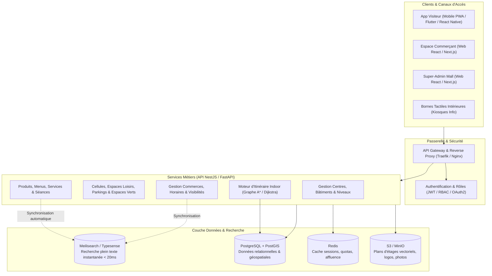

# Architecture Technique Cible - Smart Mall & Digital Indoor Commerce

## 1. Vue d'Ensemble du Système

La plateforme **Smart Mall** est conçue selon une architecture modulaire scalable, adaptée aux exigences de recherche temps réel, de guidage indoor vectoriel et de multi-tenance (plusieurs centres commerciaux, chacun abritant des dizaines ou centaines de commerces et espaces).

---

## 2. Découpage Fonctionnel des Composants

### 2.1 Applications Frontend
1. **Application Visiteur (Mobile & Kiosques)** :
   - Mode PWA (sans téléchargement obligatoire via scan de QR code sur site) ou application mobile native.
   - Barre de recherche ultra-rapide avec filtres (Catégorie, Étage, En stock, Services disponibles).
   - Carte indoor interactive (niveaux R-1, RDC, R+1, etc.) avec zoom fluide, rotation et centrage.
   - Guidage pas-à-pas depuis le point de scan QR Code ("Vous êtes à la Porte Nord") jusqu'à la boutique ou commodité (toilettes, ascenseur, cinéma).

2. **Portail Marchand (Store Portal)** :
   - Fiche d'identité boutique (nom, logo, bannière, contact, horaires normaux et exceptionnels).
   - Gestionnaire de catalogue (produits, prix, état du stock, tags de recherche).
   - Gestion des services (prise de rendez-vous, menus de restaurant, séances).
   - Localisation attribuée (visualisation de sa cellule sur le plan du centre).

3. **Portail Gestionnaire Mall (Super-Admin)** :
   - Création et modélisation des centres, bâtiments et étages.
   - Importation et calibrage des plans d'étages vectoriels (SVG / GeoJSON).
   - Découpage des cellules commerciales et points d'intérêt (toilettes, ascenseurs, bornes d'urgence).
   - Gestion des espaces spécifiques : parkings (taux de remplissage), cinéma, espaces de jeux, parcs extérieurs.
   - Statistiques de recherche : produits les plus recherchés, zones à fort passage.

---

## 3. Choix Technologiques Détaillés

| Composant | Solution retenue | Rationale technique |
| :--- | :--- | :--- |
| **Backend API** | **NestJS (TypeScript)** ou **FastAPI (Python)** | NestJS offre une architecture modulaire d'entreprise, une injection de dépendance claire et un typage strict avec TypeScript. |
| **Base Relationnelle** | **PostgreSQL 16+** | Fiabilité ACID, requêtes JSONB pour les attributs flexibles de produits/services. |
| **Module Spatial** | **PostGIS** | Support natif des polygones (cellules commerciales), lignes de cheminement et points de repère pour les calculs géométriques. |
| **Moteur de Recherche** | **Meilisearch** | Recherche tolérante aux fautes (*typo-tolerance*), scoring par pertinence, filtres à facettes et temps de réponse ultra-rapide (< 15-30ms). |
| **Indoor Mapping UI** | **Leaflet / MapLibre GL avec couches SVG/GeoJSON** | Rendu ultra-léger sur smartphone sans licence payante Google Maps / ArcGIS. |
| **Cache & Real-time** | **Redis + WebSockets** | Disponibilité des places de parking en temps réel et notification des promotions éphémères. |
