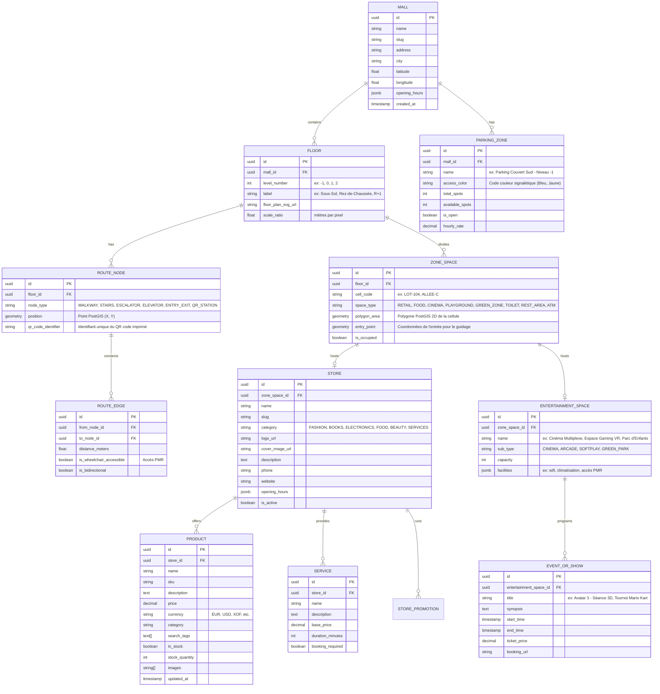

# Modèle de Données Relationnel & Spatial (PostgreSQL + PostGIS)

Ce modèle prend en compte les spécificités d'un centre commercial moderne : multi-centres, étages, typologie d'espaces diversifiés (boutiques, parkings, cinéma, loisirs, parcs), produits/services et graphe de routage piétonnier indoor.

---

## 1. Schéma Relationnel Entité-Association (Mermaid)



---

## 2. Script DDL SQL Initial (PostgreSQL + PostGIS)

```sql
-- Activation de l'extension spatiale PostGIS
CREATE EXTENSION IF NOT EXISTS "uuid-ossp";
CREATE EXTENSION IF NOT EXISTS "postgis";

-- 1. Table des centres commerciaux
CREATE TABLE malls (
    id UUID PRIMARY KEY DEFAULT uuid_generate_v4(),
    name VARCHAR(255) NOT NULL,
    slug VARCHAR(255) UNIQUE NOT NULL,
    address TEXT NOT NULL,
    city VARCHAR(100) NOT NULL,
    geom GEOMETRY(Point, 4326), -- Position GPS extérieure
    opening_hours JSONB,
    created_at TIMESTAMP WITH TIME ZONE DEFAULT NOW()
);

-- 2. Niveaux et Étages
CREATE TABLE floors (
    id UUID PRIMARY KEY DEFAULT uuid_generate_v4(),
    mall_id UUID NOT NULL REFERENCES malls(id) ON DELETE CASCADE,
    level_number INT NOT NULL,
    label VARCHAR(100) NOT NULL,
    floor_plan_svg_url TEXT,
    scale_ratio FLOAT DEFAULT 1.0,
    created_at TIMESTAMP WITH TIME ZONE DEFAULT NOW(),
    UNIQUE (mall_id, level_number)
);

-- 3. Zones et Cellules d'espaces (Polygones sur le plan)
CREATE TABLE zone_spaces (
    id UUID PRIMARY KEY DEFAULT uuid_generate_v4(),
    floor_id UUID NOT NULL REFERENCES floors(id) ON DELETE CASCADE,
    cell_code VARCHAR(50) NOT NULL,
    space_type VARCHAR(50) NOT NULL, -- RETAIL, FOOD, CINEMA, PLAYGROUND, GREEN_ZONE, TOILET, REST_AREA
    polygon_area GEOMETRY(Polygon, 0), -- Coordonnées relatives au plan d'étage
    entry_point GEOMETRY(Point, 0),    -- Point de contact avec le couloir
    is_occupied BOOLEAN DEFAULT FALSE,
    created_at TIMESTAMP WITH TIME ZONE DEFAULT NOW()
);

-- 4. Commerces & Boutiques
CREATE TABLE stores (
    id UUID PRIMARY KEY DEFAULT uuid_generate_v4(),
    zone_space_id UUID UNIQUE REFERENCES zone_spaces(id) ON DELETE SET NULL,
    name VARCHAR(255) NOT NULL,
    slug VARCHAR(255) UNIQUE NOT NULL,
    category VARCHAR(100) NOT NULL,
    logo_url TEXT,
    cover_image_url TEXT,
    description TEXT,
    phone VARCHAR(50),
    website VARCHAR(255),
    opening_hours JSONB,
    is_active BOOLEAN DEFAULT TRUE,
    created_at TIMESTAMP WITH TIME ZONE DEFAULT NOW()
);

-- 5. Produits
CREATE TABLE products (
    id UUID PRIMARY KEY DEFAULT uuid_generate_v4(),
    store_id UUID NOT NULL REFERENCES stores(id) ON DELETE CASCADE,
    name VARCHAR(255) NOT NULL,
    sku VARCHAR(100),
    description TEXT,
    price NUMERIC(10, 2) NOT NULL,
    currency VARCHAR(10) DEFAULT 'EUR',
    category VARCHAR(100),
    search_tags TEXT[] DEFAULT '{}',
    in_stock BOOLEAN DEFAULT TRUE,
    stock_quantity INT DEFAULT 0,
    images TEXT[] DEFAULT '{}',
    created_at TIMESTAMP WITH TIME ZONE DEFAULT NOW(),
    updated_at TIMESTAMP WITH TIME ZONE DEFAULT NOW()
);

-- 6. Index géospatiaux et d'optimisation
CREATE INDEX idx_zone_spaces_polygon ON zone_spaces USING GIST(polygon_area);
CREATE INDEX idx_zone_spaces_entry ON zone_spaces USING GIST(entry_point);
CREATE INDEX idx_products_store ON products(store_id);
CREATE INDEX idx_products_name ON products(name);
```
