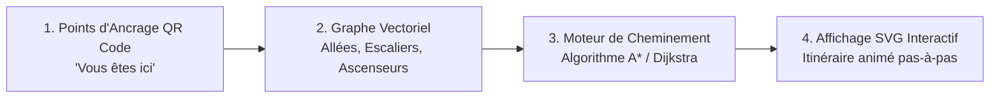

# Stratégie de Cartographie & Repérage Intérieur (Indoor Mapping Économique)

Dans un centre commercial, les signaux GPS sont bloqués ou trop imprécis. Plutôt que d'investir des dizaines de milliers d'euros dans des réseaux de balises matérielles complexes à calibrer et à maintenir (piles, pannes), nous déployons une **architecture logicielle hybride à coût matériel quasi-nul**.

---

## 1. Le Principe : Les 3 Piliers du Repérage Économique



### Pilier 1 : Bornes et Stickers QR Code ("Vous êtes ici")
- Des QR codes discrets mais identifiables sont placés aux points stratégiques :
  - Chaque entrée/porte du centre commercial (`ENTREE_NORD_RDC`, `PORTE_PARKING_P2`).
  - À chaque sortie d'ascenseur ou d'escalator (`ASCENSEUR_EST_NIV1`).
  - Aux carrefours principaux et devant chaque boutique (`DEVANT_CELLULE_104`).
- **Fonctionnement** :
  1. Le visiteur scanne le QR code avec l'appareil photo de son smartphone (sans téléchargement préalable obligatoire, ouvre directement la WebApp).
  2. L'URL contient l'identifiant du point : `https://mall.app/map?from=QR_RDC_PORTE_NORD`.
  3. L'application charge instantanément le plan du niveau correspondant et positionne le point bleu "Vous êtes ici".

### Pilier 2 : Plans d'Étages Vectoriels (SVG / GeoJSON)
- Les plans d'architecte (PDF ou DWG) ou les plans d'évacuation incendie sont convertis en formats vectoriels légers (**SVG** ou **GeoJSON**).
- Chaque boutique est un `<path>` ou un polygone avec un identifiant unique `id="cell-104"`.
- Cela permet :
  - Un zoom infini ultra-net sans flou.
  - La coloration dynamique (ex: cellule verte = ouverte, cellule surlignée = boutique recherchée).
  - Un poids plume (< 150 Ko par étage), téléchargeable en quelques millisecondes même avec une connexion 4G/3G moyenne.

### Pilier 3 : Le Graphe Piétonnier & Calcul d'Itinéraire (A* / Dijkstra)
- Au-dessus du plan vectoriel, on trace un réseau de lignes invisibles représentant les allées marchandes :
  - **Nœuds (Nodes)** : intersections, entrées de magasins, escaliers, ascenseurs.
  - **Arêtes (Edges)** : segments de marche praticables avec leur distance en mètres.
  - **Arêtes multi-étages** : les escaliers, travelators et ascenseurs connectent les nœuds du Niveau 0 aux nœuds du Niveau 1.
- Dès que le visiteur clique sur "Y aller" vers un produit ou un magasin :
  1. L'algorithme calcule le plus court chemin piéton.
  2. Option d'accessibilité PMR (Poussettes, Fauteuils roulants) : exclut automatiquement les escaliers classiques pour n'emprunter que les ascenseurs et rampes.
  3. Le tracé de la ligne s'affiche de manière animée sur le plan.

---

## 2. Exemple de Données d'un Graphe Indoor

```json
{
  "floor_id": "floor-rdc-001",
  "nodes": [
    { "id": "NODE_ENTREE_SUD", "x": 120, "y": 450, "type": "ENTRY", "label": "Entrée Sud" },
    { "id": "NODE_CARREFOUR_A", "x": 200, "y": 450, "type": "WALKWAY" },
    { "id": "NODE_STORE_FNAC", "x": 200, "y": 320, "type": "STORE_ENTRY", "store_id": "fnac-01" },
    { "id": "NODE_ASCENSEUR_1", "x": 350, "y": 450, "type": "ELEVATOR", "connects_to_floor": "floor-r1-002" }
  ],
  "edges": [
    { "from": "NODE_ENTREE_SUD", "to": "NODE_CARREFOUR_A", "distance": 25.0, "accessible_pmr": true },
    { "from": "NODE_CARREFOUR_A", "to": "NODE_STORE_FNAC", "distance": 18.0, "accessible_pmr": true },
    { "from": "NODE_CARREFOUR_A", "to": "NODE_ASCENSEUR_1", "distance": 40.0, "accessible_pmr": true }
  ]
}
```

---

## 3. Évolution Future (Sans tout refaire)
Une fois le centre validé et rentabilisé, si la direction souhaite un guidage automatique "en direct" (le point bleu qui avance tout seul sans scanner de QR code) :
- Les balises Bluetooth (BLE iBeacons) peuvent être ajoutées par-dessus ce même graphe sans changer une seule ligne de votre base de données ni de votre moteur d'itinéraire.
